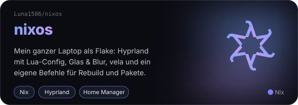
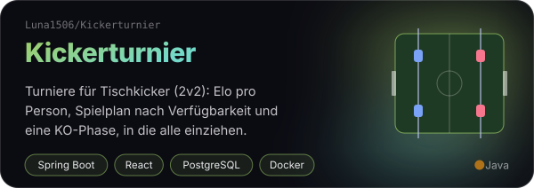
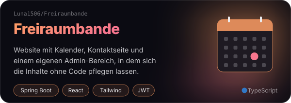

  

  
  
  

Hey, ich bin **Luna** 👋 &nbsp;Ich bastle an NixOS-Konfigurationen, baue Web-Sachen mit Java + React/TypeScript und habe immer irgendein kleines Projekt am Laufen, das niemand braucht. Aber ich brauchte es.

- 🎓 studiere an der **NORDAKADEMIE** und baue mir die Lern-Tools dafür selbst
- ❄️ mein ganzer Laptop ist eine **Nix-Flake**: Hyprland, Glas, Blur, alles deklarativ
- 🐳 hoste meine Sachen selbst: Docker, Nginx Proxy Manager, Cloudflare
- 🤖 programmiere viel mit **Claude**, sogar meine Commit-Messages schreibt Claude

---

## ✦ Woran ich baue

  
  
  
  

---

## ✦ Womit ich baue

<table align="center">
  <tr>
    <td align="right"><b>Sprachen</b></td>
    <td></td>
  </tr>
  <tr>
    <td align="right"><b>Frontend</b></td>
    <td></td>
  </tr>
  <tr>
    <td align="right"><b>Backend</b></td>
    <td></td>
  </tr>
  <tr>
    <td align="right"><b>Infra</b></td>
    <td></td>
  </tr>
  <tr>
    <td align="right"><b>Tools</b></td>
    <td></td>
  </tr>
</table>

außerdem: Neo4j · JPA · JWT · OpenAPI/Swagger · React Query · React Hook Form · React Native · Playwright · ESLint · Prettier · Jira · Confluence

---

## ✦ In Zahlen

  
  

  <picture>
    <source media="(prefers-color-scheme: dark)" srcset="https://raw.githubusercontent.com/Luna1506/Luna1506/output/snake-dark.svg">
    
  </picture>

---

  🎮 Abseits vom Code: Steam, Ubisoft und Minecraft mit viel zu vielen Fabric-Mods. 
  <code>&lt; luna@nixos ~ &gt; rebuild</code>

